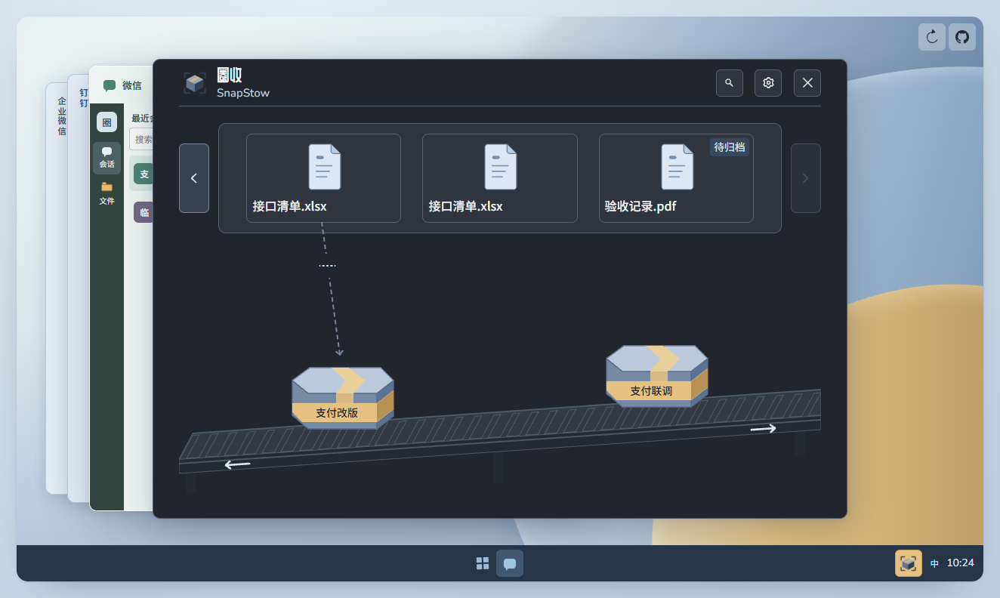

<p align="center">
  
</p>

<h1 align="center">圈收 · SnapStow</h1>

<p align="center">圈一下，松手继续工作。</p>

<p align="center">
  <a href="https://s-wuyu.github.io/SnapStow/#try"><strong>打开在线演示 ↗</strong></a>
</p>

[](https://s-wuyu.github.io/SnapStow/#try)

圈收是一款面向 Windows 的群聊资料归档工具。附件归入对应的项目文件夹，链接和备注追加到同一份 `项目资料.md`。想找回一条资料的出处时，用放大镜回看当时的圈选截图。

## 三步上手

网页演示使用示例群聊和文件。

1. **圈选**。点桌面上的「圈选群聊」，拖框圈住想留的消息或附件。
2. **入箱**。松手回到群聊。点任务栏右侧的圈收图标打开工作台，把待归档文件拖进项目箱。
3. **回看**。点击项目箱按来源浏览资料，开启放大镜看原图。右键项目箱可打开模拟文件夹，查看 `项目资料.md`。

## 本地预览

在仓库根目录运行下面的命令，然后打开 [本地演示](http://127.0.0.1:8765/#try)。

```powershell
python -m http.server 8765 --bind 127.0.0.1 --directory promo
```
