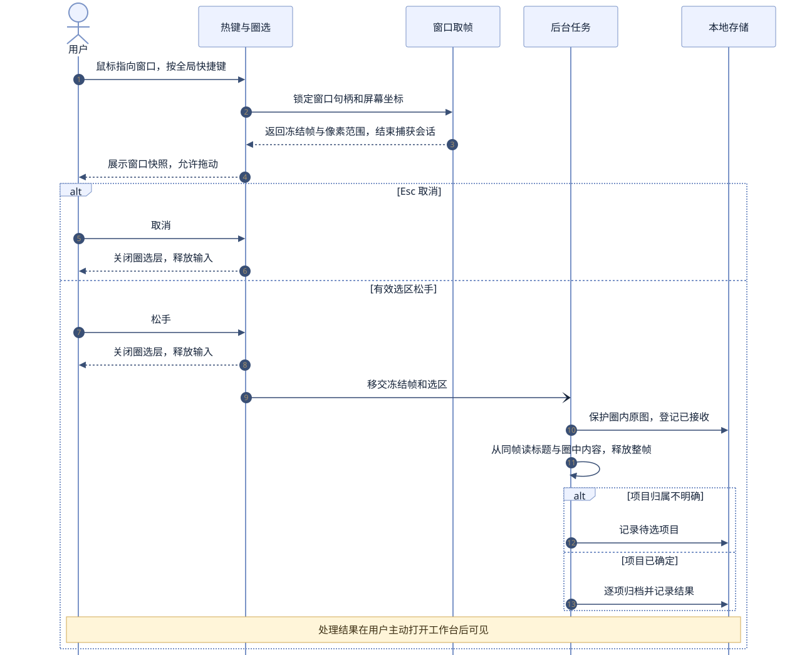

# 圈收 · SnapStow v0.1 技术设计

| 项目 | 内容 |
| --- | --- |
| 状态 | 便携发布已确认，UI 栈和查询后端待 Windows 原型验证 |
| 日期 | 2026-11-21 |
| 依据 | [产品需求与验收](../../PRD.md) · [交互与状态](../design/design.md) |
| 建议基线 | Windows 11 x64、普通用户、可写的本机目录。最低 Windows 版本和 ARM64 支持待确认。 |

**建议优先验证 Rust + Win32 + Direct2D/DirectWrite，保留 C# / .NET 10 LTS + WPF 作对照。** 原生 UI 宿主常驻托盘，圈选由 UI 线程处理，OCR、附件查询和归档交给后台。首版优先验证 Everything 加速和无需另装搜索工具的本地回退。SQLite、圈内原图和设置随软件目录保存，项目材料写入用户独立选择的工作总目录。[便携发布决定](decisions/001-portable-distribution.md)

开发前优先验证混合 DPI 下的同帧捕获与桌面交还、聊天画面里的群名与附件名识别，以及磁盘写入中断后的恢复。当前工作区处于文档阶段，下面的选型、模块名与数据表是实施建议。

## 1. 系统架构

[打开架构图](diagrams/system.svg) · [Mermaid 源码](diagrams/system.mmd)

| 模块 | 职责和边界 |
| --- | --- |
| 桌面宿主 | 按 Windows 用户会话维持单实例，接收全局热键，管理托盘、圈选层和工作台的生命周期。后台任务完成时只更新状态。 |
| Windows 适配 | 锁定鼠标下的窗口，取单帧并映射物理像素。负责系统选目录、打开资源管理器和文件身份查询。 |
| 识别与归属 | 分别使用同帧的标题区、用户圈选区。输出已识别的附件引用、网址、普通备注、账号资料引用与待确认原因。 |
| 附件查找 | 从已知下载目录生成候选，返回匹配证据和搜索覆盖情况。复制前重新验证实际文件。 |
| 归档服务 | 各资料项独立推进，将写入、重试、冲突处理、项目重命名和群迁移记录为可恢复操作。 |
| 工作台 | 从存储读取可展示状态。拖放、剪线、改接、重命名与键盘等价操作提交相同的应用命令。动画跟随命令结果。 |

建议先按宿主与 UI、规则与用例、Windows/OCR/存储适配划分模块，由宿主组装依赖。规则层的测试使用替身帧、查询替身和临时目录，Windows 专项测试覆盖真实系统边界。首轮可共用一个后台执行器，按项目串行变更。采集与 OCR 采用有界交接，避免连续圈选或大文件复制挤占界面线程。

## 2. 技术选型

| 层 | 推荐 | 理由与取舍 |
| --- | --- | --- |
| 桌面 UI | 首选原型用 Rust、`windows` crate、Direct2D/DirectWrite，按需使用合成层 | 自绘场景适合箱体、滚筒、裁剪和拖动连线。WPF 保留为对照，使用自绘视觉配合控件模板。完成下文的动画与可访问性验证后再定栈。 |
| 系统集成 | `RegisterHotKey` / `WM_HOTKEY`、`Shell_NotifyIcon`、`IFileDialog` | Rust 用 `windows` crate 调用 Win32，WPF 可用托管适配。换热键先用独立 ID 注册新组合，成功后再替换旧绑定。退出应用、收起工作台、关闭详情分别处理。 |
| 单窗口取帧 | Windows Graphics Capture 的 `CreateForWindow` + D3D11 | 可按已锁定的 HWND 取帧，切换焦点也继续用原窗口。圈选前冻结画面并结束捕获会话。保留系统捕获提示。受保护或不可用的窗口按捕获失败处理。 |
| 离线 OCR | ONNX Runtime CPU + PP-OCRv5 mobile 检测与识别模型 | 先用发布方提供的 ONNX 模型做中英混排原型。实现预处理、文字框筛选、阅读顺序和解码。固定随包发布的模型、字典与版本，按所选语言验证绑定、原生库加载和耗时。 |
| 本地附件查找 | Everything SDK / IPC + 限定目录回退 | 优先验证已有可用实例。索引漏项或不可用时由限定目录补足覆盖，用干净环境确认无需另装搜索工具也能完成归档。 |
| 写入与状态 | SQLite 与 Windows 文件系统 | SQLite 保存关联、任务与操作日志。附件和 UTF-8 Markdown 在项目目录中可直接打开。SQLite 与项目文件分开提交，由操作日志协调。 |
| 发布与测试 | Windows x64 便携 ZIP，本机分层验证 | 双击主程序，模型和所需运行库随包提供。常规测试离屏运行，真实热键与输入用本机短时手工验证。Sandbox 可选。[Windows 测试方案](windows-testing.md) |

开源 OCR 先核对模型和字典的真实加载路径、绑定和再分发方式。 [ONNX Runtime 原生接口](https://onnxruntime.ai/docs/get-started/with-c.html) · [检测模型](https://huggingface.co/PaddlePaddle/PP-OCRv5_mobile_det_onnx) · [识别模型](https://huggingface.co/PaddlePaddle/PP-OCRv5_mobile_rec_onnx)

平台接口依据见 [windows-rs](https://github.com/microsoft/windows-rs) · [RegisterHotKey](https://learn.microsoft.com/en-us/windows/win32/api/winuser/nf-winuser-registerhotkey) · [CreateForWindow](https://learn.microsoft.com/en-us/windows/win32/api/windows.graphics.capture.interop/nf-windows-graphics-capture-interop-igraphicscaptureiteminterop-createforwindow) · [系统捕获边框](https://learn.microsoft.com/en-us/uwp/api/windows.graphics.capture.graphicscapturesession.isborderrequired)

### 为什么先验证 Rust 自绘

可定制程度主要由选用的渲染层决定。Rust + Direct2D/DirectWrite 可以直接控制矢量路径、绘制顺序、离屏位图、裁剪、文字布局和命中区域。可让绘制和命中共用一份场景几何，连线随拖动锚点更新，再用 D2D 的离屏效果验证开箱底层模糊。标准编辑框和系统对话框可复用。自绘包裹、清单和连线的键盘焦点、可访问名称和 UI Automation 行为需要自己提供。[Direct2D](https://learn.microsoft.com/en-us/windows/win32/direct2d/direct2d-portal) · [DirectWrite](https://learn.microsoft.com/en-us/windows/win32/directwrite/direct-write-portal) · [UI Automation 提供程序](https://learn.microsoft.com/en-us/windows/win32/winauto/uiauto-providersoverview)

WPF 也支持模板、自绘矢量、动画和自定义 AutomationPeer，设置页、输入框和焦点管理的开发成本较低。Rust 自绘路线值得优先试，因为工作台大部分视觉和命中都有专门规则。流畅度仍取决于动画期间的每帧工作量、模糊区域和绘制资源复用。[WPF 概览](https://learn.microsoft.com/en-us/dotnet/desktop/wpf/overview/) · [WPF 自定义控件自动化](https://learn.microsoft.com/en-us/dotnet/desktop/wpf/controls/ui-automation-of-a-wpf-custom-control)

用同一份合成资料在两条路线做一个小切片。覆盖滚筒跟手翻页、箱体落点高亮、拖动连线、开箱模糊和键盘等价操作。在 440 / 920 DIP、100% / 150% 缩放、两种主题下记录呈现帧时 P95、卡顿、闲置内存、包体和关闭工作台后的占用。60 Hz 下一帧约 16.7 ms，可作为预算参考。只有自绘交互流畅且键盘与 UIA 可用时才定 Rust，WPF 达到同样目标且开发成本更低时可采用 WPF。

## 3. 技术难点

### 同一帧与松手时延

[打开圈选时序图](diagrams/capture-sequence.svg) · [Mermaid 源码](diagrams/capture-sequence.mmd)

- 快捷键到达时读取鼠标所在窗口并解析其顶层 HWND，记录来源窗口、帧尺寸和映射矩阵。界面布局使用 DIP，裁图使用帧内物理像素。映射需包括窗口边框、屏幕负坐标、跨屏及缩放差异。在 100% 和 150% 双屏下用像素标尺对照实际裁图，窗口尺寸变化或取帧异常时结束本次捕获。[Windows 桌面 DPI 指南](https://learn.microsoft.com/en-us/windows/win32/hidpi/high-dpi-desktop-application-development-on-windows)
- 保持取帧会话短暂，使用成功取得的帧显示冻结窗口。松手处理只固定矩形、释放鼠标捕获并关闭圈选层，再交接内存中的帧。GPU 资源准备可提前完成，裁剪、编码、磁盘 I/O 和 OCR 都在释放输入之后。Esc 直接释放资源。
- 后台先持久化受保护的圈内原图和任务 ID，再从同一帧分别识别标题与圈内文字，完成后释放整帧。首个持久化点前进程异常退出时，内存中的提交可能丢失。持久化后中断时可重做圈内 OCR。若当时尚未保存有效群身份，则进入「待选项目」。

### 群名、文件名和凭据识别

- **群归属。** 只使用同帧中与当前会话相符的标题线索。建议维护已确认来源 ID，并保存客户端标识与确认过的标题别名。遇到多个可疑标题、截断或同名群冲突，进入「待选项目」。项目首次归属按 PRD 优先匹配已有文件夹，有可归档内容时再创建目录。
- **附件名。** 保留 OCR 原文字框用于本次判断，使用完整文件名、扩展名、可见大小及可信来源目录验证候选。大小需考虑显示舍入。省略号与易混字符可以扩大人工候选范围，自动复制要求可靠的唯一原件。
- **账号资料。** 对疑似账号、口令、密钥、带秘密参数的链接或无法安全拆分的行保守处理。账号对象只保存截图引用与必要元数据。解析器仅将明确可写入的网址和普通备注交给 Markdown 写入器。验证样本应包含同框网址与密码、换行凭据、混排文字和 OCR 错字。

### 查询覆盖与双重重名

| 接入方式 | 结论 |
| --- | --- |
| 复用已运行的 Everything | 首选验证方案。官方 SDK 是 IPC 客户端，后台还要有 Everything 应用进程。SDK 2 与 1.4 配合，SDK 3 面向 1.5，并支持命名实例的管道连接。只有 Everything 服务在运行时，IPC 查询仍可能不可用。查询只读，复用时保持用户的设置、索引和实例生命周期。[官方 SDK](https://www.voidtools.com/support/everything/sdk/) · [查询错误](https://www.voidtools.com/support/everything/sdk/everything_query/) · [1.5 SDK 和会话](https://voidtools.com/forum/viewtopic.php?p=83309) |
| 随包提供官方便携进程 | 可做备选。使用独立命名实例，配置和数据库放到软件目录，仅启用已验证的聊天下载目录索引。普通用户可做文件夹索引，原生 NTFS 快速索引依赖服务或管理员权限。原型要核验无提权启动、实例共存、资源占用及更新方式。发布前以所用版本的发行包核对许可证和声明要求。[命名实例](https://www.voidtools.com/support/everything/multiple_instances/) · [目录索引](https://www.voidtools.com/en-us/support/everything/folder_indexing/) · [Everything 服务](https://www.voidtools.com/support/everything/everything_service/) · [开发者关于再分发的说明](https://voidtools.com/forum/viewtopic.php?t=6688) |
| 抽出 Everything 的索引内核 | 公开资料提供 IPC SDK，未找到可独立嵌入的官方索引引擎或公开核心源码。可测试官方进程接入，或自己维护限定目录文件名索引。[官方 SDK](https://www.voidtools.com/support/everything/sdk/) · [开发者关于核心源码的说明](https://www.voidtools.com/forum/viewtopic.php?t=590) |

推荐让 Everything 返回候选，限定目录查找作为每台机器都能用的路径。先覆盖 Windows 下载目录和已验证的聊天下载位置，排除 SnapStow 自己的归档目录。查询以完整文件名、扩展名和扫描范围为约束，复制前核验路径、可读性、大小与身份。当索引范围、刷新或返回结果完整性有疑问时，先补查对应目录。枚举超时、目录不可访问、索引加载中都需要记录实际覆盖，只有有效范围查完且零候选才显示「未找到」。对被跳过的重解析点或需要下载的占位文件，要区分查找覆盖不完整与原件不存在。

[打开资料项状态图](diagrams/archive-state.svg) · [Mermaid 源码](diagrams/archive-state.mmd)

**本地原件同名**需要选择来源路径。**项目内重名**发生在原件已确定后，处理的是已有归档关联与新件。剪线、改接只改变本次结果或关联，历史来源可追溯。保留两份用不覆盖的顺序编号。重试时先查操作日志和内容身份，复用可确认的归档副本。任务汇总从各资料项结果推导，所以附件查询失败时，同框文字照常写入。

### 文件一致性与中断恢复

1. 为每次写入记录稳定步骤 ID、预定目标、预期文件身份与阶段。按项目串行执行归档、迁移、重命名与资料文档写入，复制和 OCR 期间不持有 SQLite 写事务。
2. 校验目标文件名与路径归属，处理 Windows 保留名、重解析点和无权限目录。附件复制到目标同卷的临时文件，核验后以**不覆盖**的方式移入最终路径。目标被抢占时重新处理冲突。源文件已改动、被占用或复制中消失时保留可重试项。复制只读源目录。
3. Markdown 采用可识别的条目 ID，在同目录生成保留用户手写内容的临时版本，再替换已有文件或创建新文件。写入前核对已读版本，发现外部编辑则重读合并或保留失败供重试。替换时保留旧版备份，供提交前核验和恢复。测试外部编辑与替换同时发生时，能否保住两边的内容。
4. 写入成功并验证后再提交资料状态。进程重启时检查日志、临时文件和目标，确认身份才补记完成。未完成步骤可重试。文件已出现但日志未提交是必测窗口，重复运行不得覆盖用户文件或重复追加条目。[SQLite 事务](https://learn.microsoft.com/en-us/dotnet/standard/data/sqlite/transactions) · [Windows 文件替换](https://learn.microsoft.com/en-us/windows/win32/api/winbase/nf-winbase-replacefilew)

### 来源追踪、群迁移与项目管理

- 同一项目内的外部移位优先用卷序列号 + File ID 验证，其次用能唯一匹配的内容指纹。监听到改动时标记需核对，启动或打开项目时对账。重名、多个内容匹配或文件标识不可用时进入确认。项目目录路径变化时查证新目录，文件来源继续引用稳定的来源 ID。[Windows 文件标识](https://learn.microsoft.com/en-us/windows/win32/api/winbase/ns-winbase-file_id_info) · [FileSystemWatcher 的通知限制](https://learn.microsoft.com/en-us/dotnet/api/system.io.filesystemwatcher)
- 群资料拖到待办仅登记意图，原地保留资料。放回即撤回。跨项目放置先准备目标文件和 Markdown 条目，保留源映射，完成后再更新归属。在同一群的迁移和新圈选之间校验来源版本，迁移完成前排队重判归属，避免中途写回旧项目。一部分写入失败时保留已完成步骤与原归档，重试只补齐剩余部分。
- 新归属提交后，凭操作日志核验身份再移除本次迁出的旧项目副本和对应条目。仍被其他资料引用、已在外部改动或由用户自行加入的文件保留。清理失败单独记账，映射仍指向已验证的目标。箱内归并可以合并清单呈现，两个来源 ID 和各自的捕获历史继续独立。
- 项目重命名先验证目录名可用，再登记并执行目录改名、提交项目路径。失败时保留已确认绑定。若进程在目录改名后中断，恢复先核对目录身份再补写或回退。用户独立选择工作总目录，切换工作总目录时的项目绑定与历史处理待确认。

[打开归属迁移图](diagrams/migration.svg) · [Mermaid 源码](diagrams/migration.mmd)

### 自定义工作台和本地隐私

- 工作台的键盘和指针操作提交同一条应用命令。绘制层处理连线、命中轮廓和动画。缩放、减少动效和读屏按设计验收。目录汇总与预览解码在后台按需运行。
- 圈内原图随软件目录保存，建议使用当前用户的 Windows DPAPI 保护，放大镜按需解密。同机同账号搬目录作为首版验收。更换机器或用户的解密策略待确认。进程内尽快释放截图缓冲与原始 OCR 结果。日志只写操作 ID、阶段、耗时和有限错误码。产物验证使用合成截图与账号。[Windows DPAPI](https://learn.microsoft.com/en-us/windows/win32/api/dpapi/nf-dpapi-cryptprotectdata)

## 4. 本地数据模型

[打开数据关系图](diagrams/data-model.svg) · [Mermaid 源码](diagrams/data-model.mmd)

| 位置 | 数据 |
| --- | --- |
| 软件目录内的应用数据，如 `data/` | SQLite、设置、工作总目录配置、项目与附件的相对路径、来源映射、截图引用、资料项、待确认候选、稳定条目 ID、缓存和日志。可重试文字写入仅保留经过筛选的资料字段。 |
| 软件目录内的截图存储，如 `data/captures/` | 用户圈选的原始像素，建议无损编码后加密。多份资料可回看同一张图。待选、失败及历史状态沿用 PRD 的来源留存要求。 |
| 用户选择的工作总目录 | 项目文件夹、已复制附件和项目资料 Markdown。建议在设置中保存工作总目录的绝对路径，项目目录相对工作总目录记账，归档文件路径相对所在项目记账。 |

启动时以可执行文件自身位置确定应用数据根目录。分别核验应用数据写入位于软件目录内，归档写入位于用户选定的工作总目录内，并处理重解析点与不可写路径。升级时保留应用数据目录，SQLite 数据迁移随版本验证。搬动软件目录后仍按原工作总目录配置定位项目材料。目录名为建议，整体布局遵循[便携发布决定](decisions/001-portable-distribution.md)。

一个已识别来源当前最多绑定一个项目。单次捕获可以有多份资料。捕获来源、项目与归档对象引用允许在确认、写入前为空。多个资料项可以复用同一附件副本，同时保留各自的捕获来源。归属待确认在捕获任务层记录，附件候选与冲突在资料项层记录。项目 ID 和来源 ID 独立于目录名与群显示名。

## 5. 两个参考项目怎么用

| 参考 | 已核对的做法 | 在 SnapStow 的应用 |
| --- | --- | --- |
| **ftop** | Swift Package 把 `FtopCore`、`FtopSensors` 与 `FtopUI` 拆为独立目标，UI 依赖 Core。README 记录了隐藏状态下减少采样、窗口尺寸适配与减少动效。 | 把 Win32 和识别适配放到 UI 外。工作台收起时停止绘制动画与目录预览，热键与已提交任务继续工作。用宽窄窗口和隐藏状态分别测资源占用。[模块清单](https://github.com/Nongfsq/ftop/blob/e81bb65eba519172d48e6635186e1c15a905f6ff/Package.swift) · [ftop README](https://github.com/Nongfsq/ftop/blob/e81bb65eba519172d48e6635186e1c15a905f6ff/README.md) |
| **frun** | Rust 调用 Win32 和 Direct2D。启动入口分派 `--scan`，平台层启动无窗口扫描进程并监听目录变更。索引层维护本地缓存。 | 对照按鼠标所在屏幕定位、Per-Monitor DPI、热键生命周期和扫描隔离。首版用进程内后台执行器实现相同的响应边界，出现可复现的原生库不稳定时再评估子进程。frun 的查找服务于程序启动。SnapStow 要对误归档负责，因此以更保守的文件身份验证和覆盖状态为准。[窗口宿主](https://github.com/Nongfsq/frun/blob/d34f05e98c720974e97cdb9c61c44f090929d54e/src/app.rs) · [平台层](https://github.com/Nongfsq/frun/blob/d34f05e98c720974e97cdb9c61c44f090929d54e/src/platform.rs) · [索引](https://github.com/Nongfsq/frun/blob/d34f05e98c720974e97cdb9c61c44f090929d54e/src/index.rs) |

两套仓库的离屏渲染、目录夹具、进程回收和本地检查入口在 [Windows 测试方案](windows-testing.md) 中逐项对照。

## 6. 实施与验证顺序

| 阶段 | 原型交付 | 通过证据 |
| --- | --- | --- |
| UI 选型切片 | Rust 自绘工作台小切片，WPF 同场景对照 | 比较帧时间、输入跟手、窄窗、键盘和 UIA、实现成本。切片可用离屏和隔离会话验证。 |
| A · 捕获与释放 | 托盘、热键、鼠标目标窗口、冻结帧、矩形裁选 | 焦点在另一窗口仍抓对来源。混合缩放裁图像素正确。取消无任务。取帧异常能恢复。热键占用保留旧值。大任务进行时松手仍立即交还桌面。 |
| B · 识别与落盘 | 用合成聊天图串通标题、附件、网址、备注、凭据回看 | 对照群身份、附件完整名、条目和截图引用。覆盖同名群、中文截断、凭据混排。断网运行，确认凭据只可从本地原图回看。 |
| C · 查找与恢复 | Everything 查询与目录回退、重名、任务日志和恢复 | 覆盖可用实例、未装 Everything、同名、权限失败、索引过期。分别在文件落盘前、落盘后但数据库提交前终止测试进程。重跑能复用或补齐，原件与用户手写内容保留。 |
| D · 归并与工作台 | 对接双分页、状态、放大镜、群迁移、项目改名与便携包 | 两种窗口宽度和主题可操作，键盘等价。故障后群原档案可见、重试无重复。验证文件移入子目录与共享副本保留。在本机分别验证软件目录内的运行数据、工作总目录中的项目材料，以及只搬动软件目录后的访问。另计干净系统覆盖。 |

沿用 PRD 的 P95 目标。热键到可拖动 ≤ 150 ms，松手到可操作桌面 ≤ 100 ms，松手到一条普通文字或一个小附件写入完成 ≤ 1 s。用单调时钟分别打点，并实测圈选层消失后的桌面可交互时刻。记录 Windows 版本、CPU、磁盘、DPI、样本量、冷暖启动与附件尺寸。1 秒目标的小附件大小以样本验证结果确定。补记一次圈选即归对的比例、误归档与待确认原因，以及同批任务的手工耗时。[PRD 性能验收](../../PRD.md#5-性能与体验验收)

尚待实测的决定包括 UI 栈、Everything 接入与版本、最小 Windows 版本、真实下载根目录、同名群判断线索、OCR 准确率与性能、工作总目录切换规则。先用合成窗口验证阶段 A 的同帧和松手时延，再用工作台切片验证渲染路线。
